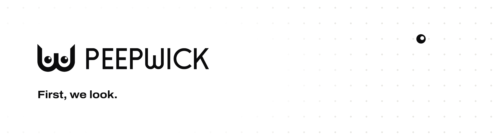
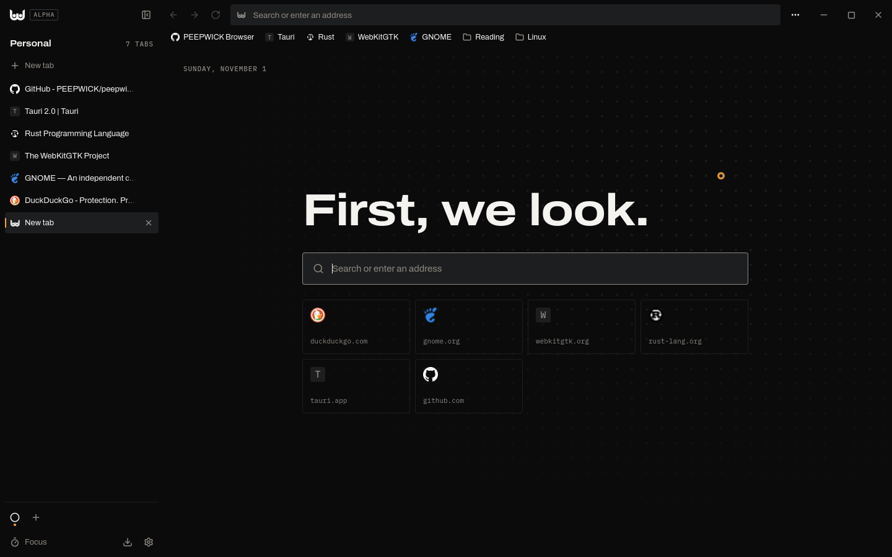

  <picture>
    <source media="(prefers-color-scheme: dark)" srcset="banner-dark.png">
    
  </picture>

**PEEPWICK** is one brand with several lines of business, under one roof and one principle: look
closely first, then make. This is where we build in the open.

## PEEPWICK Browser

**The browser that guards your attention.** It blocks ads and trackers, keeps your spaces apart
and stays quiet: a black-and-white frame that lets the pages you visit keep their own color.
Fingerprinting protection, cookie banners rejected for you, HTTPS-Only and signed updates. Written
in Rust with Tauri and WebKitGTK, for Linux.

[**Download**](https://github.com/PEEPWICK/peepwick-browser/releases/tag/v0.2.1a)
&nbsp;·&nbsp; [Source code](https://github.com/PEEPWICK/peepwick-browser)
&nbsp;·&nbsp; ALPHA · GPL-3.0

## One roof, different fields

| Line | What it does |
| --- | --- |
| **PEEPWICK&nbsp;Media** | A digital media and communications agency that runs strategy, content and paid media from one plan. |
| **PEEPWICK&nbsp;Games** | Our games line. Every game ships under its own name; MASKOFF, a social game you play in the browser, is in Early Access. |
| **PEEPWICK&nbsp;Animation** | Our animation studio: carefully drawn cartoon series, in English [on YouTube](https://www.youtube.com/@peepwickanimation). The first one is WISP. |
| **PEEPWICK&nbsp;Browser** | The browser that guards your attention. Open source, for Linux. |

## Shared principles

| Principle | What it means |
| --- | --- |
| **Look first** | We observe before we decide. |
| **Say it plainly** | We tell the truth clearly, and on time. |
| **Care** | Small details are the foundation of big trust. |
| **Evidence** | We rely on evidence, not opinion. |
| **Ownership** | We own the outcome of the work we take on. |
| **Simplicity** | We cut what isn't needed. |

## Contact

For bugs and ideas, open an issue on the project. Please report security issues privately, as
described in our [security policy](https://github.com/PEEPWICK/.github/blob/main/SECURITY.md).

[Instagram](https://www.instagram.com/peepwick/) &nbsp;·&nbsp; [X](https://x.com/peepwick)
&nbsp;·&nbsp; [YouTube · PEEPWICK Animation](https://www.youtube.com/@peepwickanimation)
